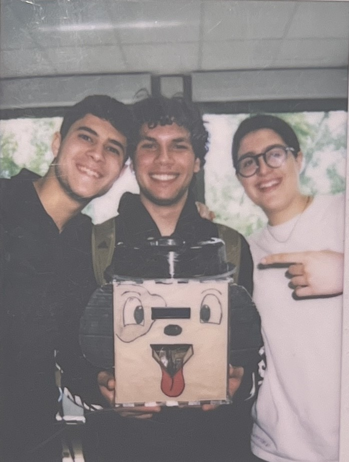

# Automatic dog feeder (Arduino)

An automatic pet-food dispenser built for a university instrumentation course (PHY404 *Instrumentation physique*, Université Grenoble Alpes, spring 2025). A real-time clock triggers each dispense: a servo turns a 4-compartment separator by one step, a buzzer tells the animal it is time to eat, and an I2C LCD shows the clock and the status.

**My work:** I designed the mechanics (SolidWorks model, laser-cut Plexiglas box), wired the electronics and wrote the Arduino code.

## Hardware
| Part | Connection |
|---|---|
| Arduino (Uno-type) | 5 V / GND shared through a breadboard |
| SG90 servo | signal on **D8** |
| Active buzzer | **D5** |
| I2C LCD 16×2 (address `0x27`) | SDA / SCL |
| RTC DS1307 | SDA / SCL |

## Mechanics
- Box made of 4 mm laser-cut Plexiglas, modelled in SolidWorks.
- Radial separator with 4 compartments (45° each) fixed on the servo.
- Slide made from a Plexiglas plate heated and bent to 60° to guide the food to the outlet.

## Software
Sketch: [`dog_feeder/dog_feeder.ino`](dog_feeder/dog_feeder.ino). Libraries: `Servo`, `LiquidCrystal_I2C`, `RTClib`.

- Each trigger turns the separator by one compartment (`STEP_ANGLE`), shows the step on the LCD and sounds the buzzer for 1 s; after the 4th compartment the next trigger returns the servo to `HOME_ANGLE` so it can be refilled.
- Servo movement is done one degree at a time for a smooth motion; the buzzer and the screen messages are timed with `millis()`.
- **Demo mode:** triggers happen every `TRIGGER_INTERVAL_S` = 10 seconds. Feeding at fixed times of day is not implemented in this sketch.

### Calibration
`HOME_ANGLE` and `STEP_ANGLE` must be adjusted on the real separator. The sketch refuses to compile if `HOME_ANGLE + NB_DISPENSES × STEP_ANGLE` exceeds 180°. The values in the file (0° and 45°) are defaults and have **not** been tested on the hardware.
